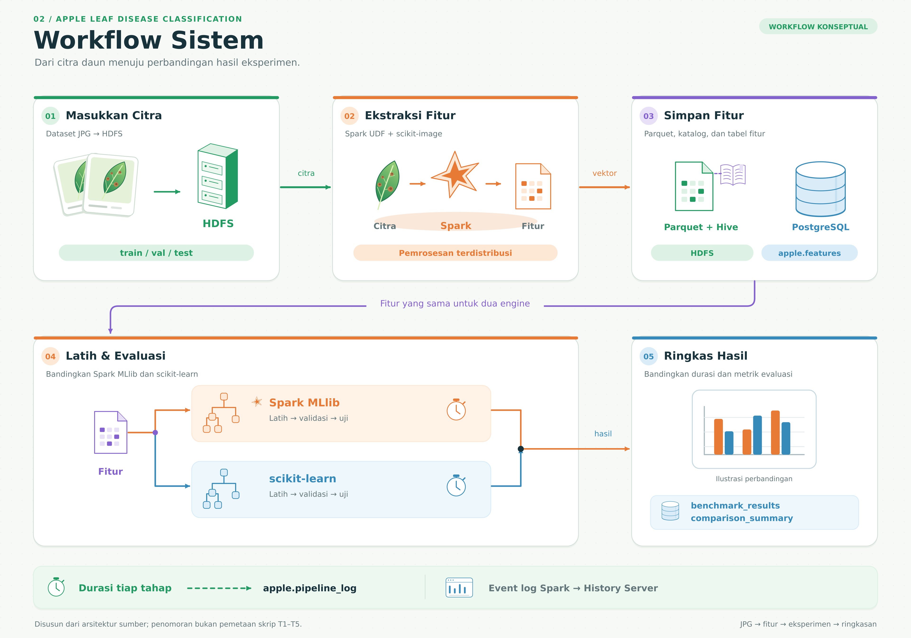
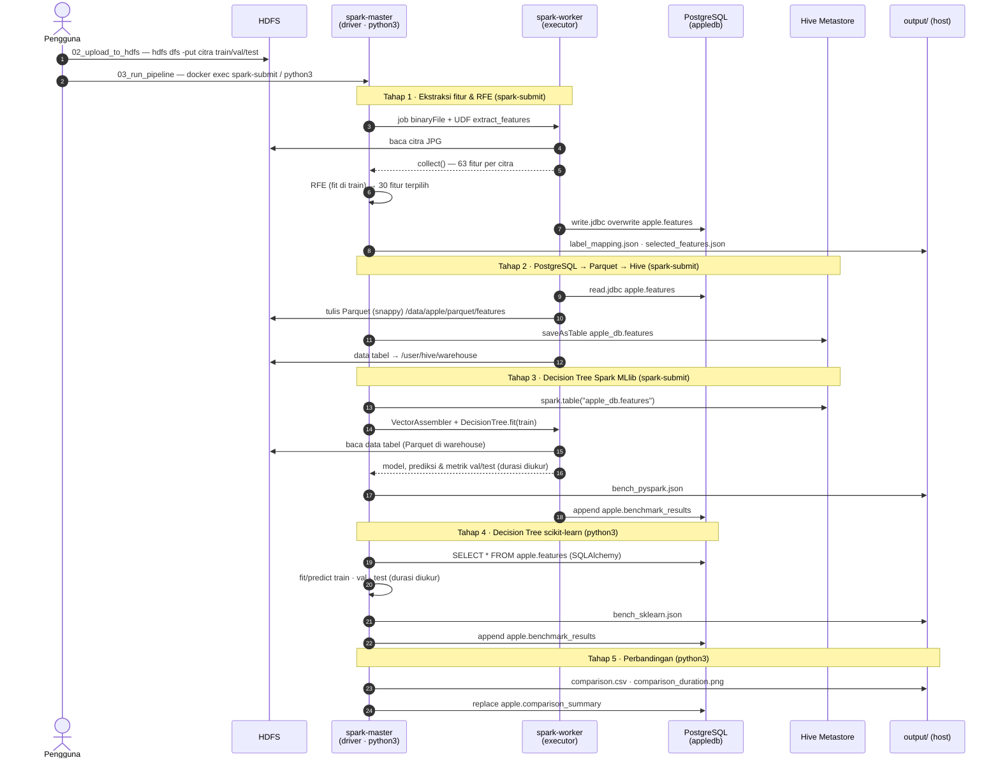
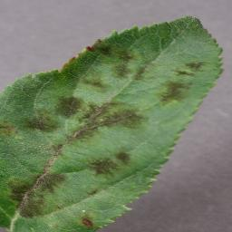
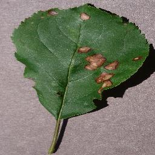
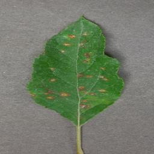
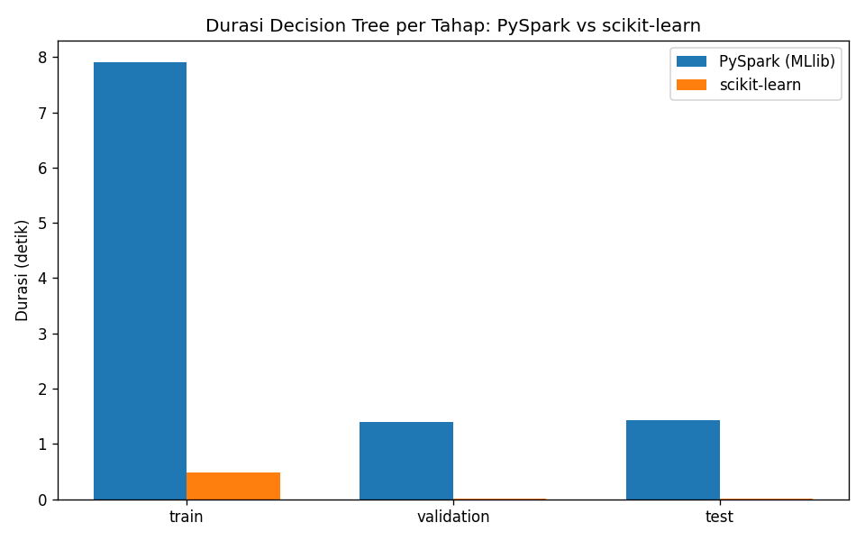

<div align="center">

# 🍎 Apple Leaf Disease Classification

**Pipeline big data end-to-end untuk klasifikasi penyakit daun apel di atas HDFS · Apache Spark · Apache Hive · PostgreSQL, sepenuhnya berjalan di Docker.**


</div>

---

Penyakit daun seperti *apple scab*, *black rot*, dan *cedar apple rust* menurunkan kualitas dan hasil panen apel, sehingga identifikasi dini dari citra daun sangat membantu. Proyek ini membangun **sistem analisis klasifikasi citra di atas big-data stack** yang dapat dijalankan di satu komputer melalui Docker Compose, mulai dari penyimpanan citra mentah sampai perbandingan kinerja model.

Pipeline terdiri atas lima tahap:

1. **Ekstraksi fitur dan seleksi.** Spark mengekstraksi **63 fitur numerik** (warna RGB/HSV, histogram, tekstur GLCM) dari setiap citra secara terdistribusi. *Recursive Feature Elimination* (RFE) kemudian memilih **30 fitur**, dan hasilnya disimpan ke **PostgreSQL**.
2. **Pemindahan ke data lake.** Data dari PostgreSQL ditulis ke **HDFS dalam format Parquet** dan didaftarkan sebagai **tabel Hive**.
3. **Decision Tree Spark MLlib.** Model dilatih dan dievaluasi, dan durasi training, validation, serta testing diukur.
4. **Decision Tree scikit-learn.** Model pembanding dilatih dengan data dan parameter yang setara.
5. **Perbandingan.** Durasi dan metrik kedua framework dibandingkan, lalu disimpan ke CSV, grafik, dan PostgreSQL.


## Arsitektur Teknologi

<picture>
  <source media="(prefers-color-scheme: dark)" srcset="docs\01-arsitektur-sistem-kreatif.png">
  
</picture>

| Container | Image | Port host | Peran |
|---|---|---|---|
| `namenode` | `bde2020/hadoop-namenode:2.0.0-hadoop3.2.1-java8` | 9870 (UI), 9000 (RPC) | Metadata HDFS; `./data` di-mount ke `/source-data` (read-only) |
| `datanode` | `bde2020/hadoop-datanode:2.0.0-hadoop3.2.1-java8` | 9864 (UI) | Penyimpan blok data HDFS (`replication = 1`) |
| `spark-master` | `apple-spark:3.3.2` *(build lokal)* | 7077, 8080, 4040 | Spark Master dan driver; tempat seluruh tahap pipeline dieksekusi |
| `spark-worker` | `apple-spark:3.3.2` | 8081 | Executor (2 core, 2 GB) |
| `spark-history` | `apple-spark:3.3.2` | 18080 | Riwayat job dari event log di `hdfs:///spark-logs` |
| `hive-metastore` | `bde2020/hive:2.3.2-postgresql-metastore` | 9083 | Katalog tabel Hive (thrift) |
| `hive-server` | `bde2020/hive:2.3.2-postgresql-metastore` | 10000 (JDBC), 10002 (UI) | HiveServer2 untuk klien SQL |
| `hive-metastore-postgresql` | `bde2020/hive-metastore-postgresql:2.3.0` | — (internal) | Backend metadata Hive Metastore |
| `postgres` | `postgres:15` | 5432 | DB aplikasi `appledb`, schema `apple` |


## Workflow Sistem

<picture>
  <source media="(prefers-color-scheme: dark)" srcset="docs/02-workflow-sistem-kreatif.png">
  
</picture>

| Tahap | Skrip (runner) | Yang dilakukan |
|:---:|---|---|
| 1 | `step1_extract_features.py` (`spark-submit`) | Membaca citra dari HDFS, mengekstraksi 63 fitur per citra di executor, menjalankan RFE pada train, lalu menyimpan 30 fitur terpilih ke `apple.features` |
| 2 | `step2_postgres_to_hive.py` (`spark-submit`) | Membaca `apple.features` via JDBC, menulis Parquet snappy ke HDFS, lalu mendaftarkan tabel Hive `apple_db.features` dan memverifikasinya dengan Spark SQL |
| 3 | `step3_train_spark_dt.py` (`spark-submit`) | Melatih dan mengevaluasi Decision Tree MLlib dari tabel Hive, lalu mencatat durasi dan metrik ke JSON dan `apple.benchmark_results` |
| 4 | `step4_train_sklearn_dt.py` (`python3`) | Melatih Decision Tree scikit-learn dari PostgreSQL dengan parameter setara, lalu mencatat durasi dan metriknya |
| 5 | `step5_compare_results.py` (`python3`) | Menyusun perbandingan per tahap beserta TOTAL dan rasio, lalu menyimpannya ke CSV, PNG, dan `apple.comparison_summary` |

Setiap tahap bergantung pada output tahap sebelumnya, sehingga `scripts/03_run_pipeline` menjalankannya berurutan di dalam container `spark-master`.

<details>
<summary><b>Diagram sekuens (Mermaid)</b>: siapa memanggil siapa di setiap tahap</summary>



</details>

## Dataset

Sumber: [Apple Disease Dataset (Kaggle)](https://www.kaggle.com/datasets/showravdhar/apple-disease-dataset), berupa citra daun RGB berukuran **256 × 256 px** (JPG) yang sudah dibagi menjadi train, val, dan test. Salinan dataset tersedia di `data/Apple_Disease_Dataset/`. Nama folder kelas dipakai langsung sebagai label.

<table>
  <tr>
    <td align="center"><br><sub><b>Apple_scab</b></sub></td>
    <td align="center"><br><sub><b>Black_rot</b></sub></td>
    <td align="center"><br><sub><b>Cedar_apple_rust</b></sub></td>
    <td align="center"><br><sub><b>healthy</b></sub></td>
  </tr>
</table>

| Kelas (indeks label) | Penyakit / patogen | Train | Val | Test | Total |
|---|---|---:|---:|---:|---:|
| `Apple_scab` (0) | Kudis apel, *Venturia inaequalis* | 2.016 | 3 | 504 | 2.523 |
| `Black_rot` (1) | Busuk hitam, *Botryosphaeria obtusa* | 1.987 | 0 | 497 | 2.484 |
| `Cedar_apple_rust` (2) | Karat cedar-apel, *Gymnosporangium juniperi-virginianae* | 1.760 | 4 | 440 | 2.204 |
| `healthy` (3) | Daun sehat | 2.008 | 0 | 502 | 2.510 |
| **Total** | | **7.771** | **7** | **1.943** | **9.721** |

Kelas relatif seimbang (masing-masing 22–26% dari data train). Sekitar 64% citra merupakan hasil augmentasi (rotasi, *flip*, serta variasi warna/piksel) dari foto daun yang sama (#catatan-validitas-evaluasi).

## Rekayasa Fitur dan Seleksi RFE

Setiap citra diubah ke RGB, di-*resize* ke **128 × 128**, lalu diekstraksi menjadi vektor **63 fitur** dengan urutan tetap sehingga skema kolom di PostgreSQL, Parquet, dan Hive selalu konsisten.

| Kelompok fitur | Rincian | Jumlah | Terpilih RFE |
|---|---|:---:|:---:|
| Statistik RGB | mean, std, min, max, persentil 25/50/75 untuk kanal R, G, B | 21 | 7 |
| Statistik HSV | mean dan std untuk kanal H, S, V | 6 | 5 |
| Histogram RGB | 8 bin ternormalisasi per kanal | 24 | 12 |
| Tekstur GLCM | contrast, dissimilarity, homogeneity, energy, correlation, ASM (mean dan std) pada 8 level abu-abu, jarak {1, 2}, sudut {0°, 45°, 90°, 135°} | 12 | 6 |
| **Total** | | **63** | **30** |

**Konfigurasi RFE:** `DecisionTreeClassifier(max_depth=8, random_state=42)` sebagai estimator, `n_features_to_select=30`, `step=5`, di-*fit* hanya pada split train, lalu *mask*-nya diterapkan ke val dan test.

Beberapa pola dari hasil seleksi: fitur HSV hampir semuanya bertahan (5 dari 6), yang mengisyaratkan bahwa *hue* dan saturasi sangat diskriminatif untuk bercak penyakit. Sebaliknya, tidak ada statistik kanal biru yang terpilih; informasi kanal biru hanya terwakili oleh 3 bin histogram.

<details>
<summary><b>Daftar 30 fitur terpilih</b> (<code>output/selected_features.json</code>)</summary>

| Kelompok | Fitur |
|---|---|
| Statistik RGB | `rgb_R_std`, `rgb_R_min`, `rgb_R_max`, `rgb_G_std`, `rgb_G_min`, `rgb_G_max`, `rgb_G_p50` |
| Statistik HSV | `hsv_H_mean`, `hsv_H_std`, `hsv_S_mean`, `hsv_S_std`, `hsv_V_std` |
| Histogram | `hist_R_1`, `hist_R_2`, `hist_R_5`, `hist_R_6`, `hist_R_7`, `hist_G_0`, `hist_G_1`, `hist_G_5`, `hist_G_6`, `hist_B_1`, `hist_B_2`, `hist_B_4` |
| GLCM | `glcm_contrast_mean`, `glcm_dissimilarity_mean`, `glcm_energy_std`, `glcm_correlation_mean`, `glcm_correlation_std`, `glcm_ASM_std` |

</details>

## Model dan Protokol Evaluasi

Decision Tree tidak memerlukan penskalaan fitur, sehingga vektor fitur dipakai apa adanya. Parameter kedua framework dibuat setara:

| Aspek | Spark MLlib (Tahap 3) | scikit-learn (Tahap 4) |
|---|---|---|
| Sumber data | Tabel Hive `apple_db.features` | Tabel PostgreSQL `apple.features` (isi identik) |
| Kedalaman maksimum | `maxDepth=10` | `max_depth=10` |
| Sampel minimum | `minInstancesPerNode=2` | `min_samples_leaf=2` |
| Kandidat *split* | `maxBins=32` (fitur kontinu didiskretisasi) | Semua *threshold* (eksak) |
| Seed | `seed=42` | `random_state=42` |
| Metrik | `MulticlassClassificationEvaluator`: accuracy, f1, weightedPrecision, weightedRecall | accuracy, F1/precision/recall `average="weighted"` |
| Durasi yang diukur | `fit` (train); `transform` + evaluasi (val, test) | `fit` (train); `predict` + metrik (val, test) |

## Hasil

| Tahap | n | Akurasi<br><sub>MLlib / sklearn</sub> | F1 *weighted*<br><sub>MLlib / sklearn</sub> | Durasi<br><sub>MLlib / sklearn</sub> | Rasio durasi<br><sub>MLlib ÷ sklearn</sub> |
|---|---:|:---:|:---:|:---:|:---:|
| Train | 7.771 | 97,43% / 97,50% | 97,42% / 97,51% | 7,906 s / 0,479 s | 16,5× |
| Validation | 7 | 85,71% / 85,71% | 91,43% / 91,43% | 1,395 s / 0,010 s | 142× |
| Test | 1.943 | **93,82%** / 93,26% | **93,80%** / 93,26% | 1,424 s / 0,012 s | 118× |
| **Total** | | | | **10,724 s / 0,501 s** | **21,4×** |

<p align="center">
  
</p>

## Tech Stack

| Lapisan | Teknologi | Versi | Peran |
|---|---|---|---|
| Orkestrasi | Docker Compose, Docker Desktop (WSL2) | Compose v2 | 9 container, jaringan bridge `apple-net`, 4 volume persisten |
| Storage | Hadoop HDFS (image bde2020) | 3.2.1 | Citra mentah, Parquet, Hive warehouse, event log Spark |
| Compute | Apache Spark standalone + PySpark | 3.3.2 | Ekstraksi fitur terdistribusi, Spark SQL, MLlib |
| Data warehouse | Apache Hive (Metastore + HiveServer2) | 2.3.2 | Katalog tabel `apple_db.features` |
| Database | PostgreSQL | 15 | Fitur hasil preprocessing, benchmark, log pipeline |
| Runtime | Python, OpenJDK | 3.10, 11 | Bahasa pipeline dan JVM Spark |
| Pengolahan citra | Pillow, scikit-image, NumPy | 10.2.0, 0.22.0, 1.26.4 | Decode, resize, HSV, GLCM |
| Machine learning | scikit-learn, Spark MLlib | 1.3.2, 3.3.2 | RFE dan Decision Tree |
| Akses data | pandas, SQLAlchemy, psycopg2, JDBC PostgreSQL | 2.1.4, 2.0.25, 2.9.9, 42.6.0 | Baca/tulis PostgreSQL dari Python dan Spark |
| Visualisasi | matplotlib | 3.8.2 | Grafik perbandingan durasi |
| Otomasi | Bash, PowerShell | — | Skrip `00`–`04` untuk Linux/macOS/WSL dan Windows |

## Cara Menjalankan

### Prasyarat

- Untuk OS Windows menggunakan Docker Desktop (backend WSL2), atau untuk OS **Linux/macOS** dengan Docker Engine dan Compose v2.
- Alokasi Docker minimal **8 GB RAM** (disarankan 10–12 GB) dan **4 CPU**, serta ruang disk kosong sekitar **15 GB**.
- Port berikut harus kosong: 4040, 5432, 7077, 8080, 8081, 9000, 9083, 9864, 9870, 10000, 10002, 18080.

### Langkah Cepat

```bash
git clone https://github.com/<username>/AppleDiseaseClassification.git
cd AppleDiseaseClassification

bash scripts/01_build_up.sh         # build image Spark kustom + docker compose up -d
bash scripts/00_check_services.sh   # ulangi sampai semua layanan berstatus [ OK ]
bash scripts/02_upload_to_hdfs.sh   # unggah data/Apple_Disease_Dataset ke HDFS
bash scripts/03_run_pipeline.sh     # jalankan Tahap 1–5 secara berurutan
bash scripts/04_teardown.sh         # hentikan container (tambahkan --purge untuk menghapus volume)
```

Di Windows (PowerShell):

```powershell
Set-ExecutionPolicy -Scope Process -ExecutionPolicy Bypass
.\scripts\01_build_up.ps1
.\scripts\00_check_services.ps1
.\scripts\02_upload_to_hdfs.ps1      # -DatasetSubdir "" jika train/val/test langsung di data/
.\scripts\03_run_pipeline.ps1
.\scripts\04_teardown.ps1            # -Purge untuk menghapus volume
```
> NOTE:
> Saat pertama kali dijalankan, image dasar perlu diunduh sehingga prosesnya memakan beberapa menit. Tunggu sekitar 1–2 menit setelah `01_build_up` agar HDFS dan Hive Metastore benar-benar siap sebelum menjalankan pipeline.

### Web UI

| Layanan | URL |
|---|---|
| HDFS NameNode | http://localhost:9870 |
| HDFS DataNode | http://localhost:9864 |
| Spark Master | http://localhost:8080 |
| Spark Worker | http://localhost:8081 |
| Spark Application UI (hanya saat job berjalan) | http://localhost:4040 |
| Spark History Server | http://localhost:18080 |
| HiveServer2 | http://localhost:10002 |
| PostgreSQL (klien SQL, bukan web) | `localhost:5432`, user `appleuser`, DB `appledb` |

<!-- Ganti baris di bawah dengan nama dan tautan Anda -->
**Penulis:** Nama Anda · [GitHub](https://github.com/username) · [LinkedIn](https://www.linkedin.com/in/username)
